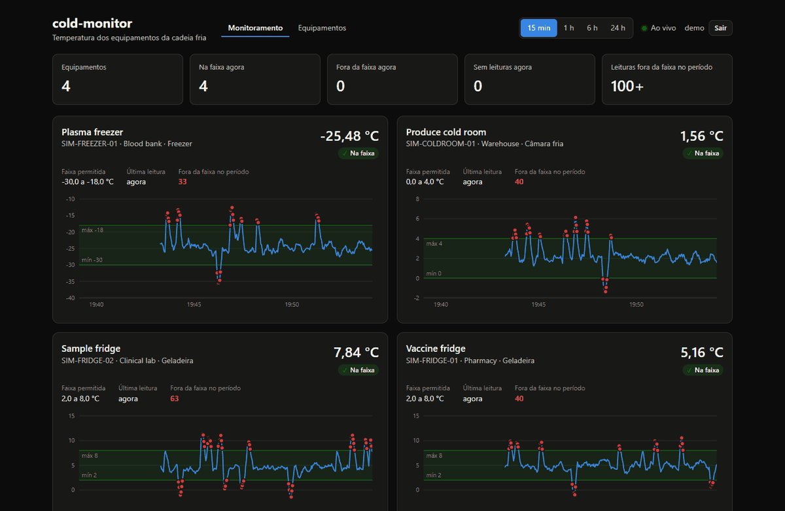
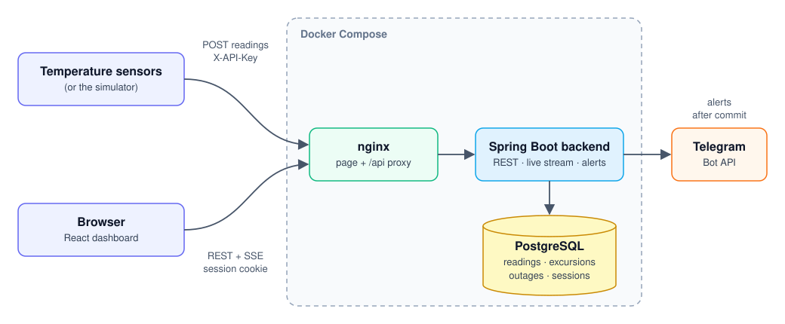
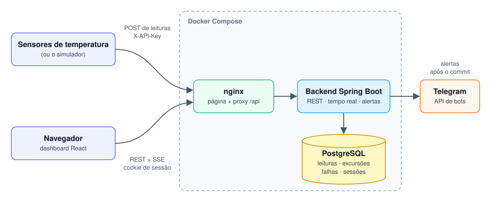

# cold-monitor-infra

[English](#english) · [Português (Brasil)](#português-brasil)

---

## English

**cold-monitor** monitors the temperature of fridges, freezers and cold rooms that store vaccines, blood products,
food and other goods that spoil outside a narrow range. Sensors send readings to a Spring Boot API, a React dashboard
shows every piece of equipment live, and a Telegram message goes out when an equipment leaves its range, when its
sensor goes silent, and again when either situation is over.

This repository runs the whole system around the clock with Docker Compose: PostgreSQL, the
[backend](https://github.com/carloslpv/cold-monitor-backend), the
[dashboard](https://github.com/carloslpv/cold-monitor-dashboard) and, optionally, the
[sensor simulator](https://github.com/carloslpv/cold-monitor-simulator). It is also the place to start reading about
the project.



### Repositories

| Repository | What it is | Stack |
| --- | --- | --- |
| [cold-monitor-backend](https://github.com/carloslpv/cold-monitor-backend) | REST API, live stream, excursion and offline-sensor alerts | Java 25, Spring Boot 4.1, PostgreSQL 18, Flyway, Testcontainers |
| [cold-monitor-dashboard](https://github.com/carloslpv/cold-monitor-dashboard) | Live monitor and equipment management | React 19, TypeScript 6, Vite 8, Recharts |
| [cold-monitor-simulator](https://github.com/carloslpv/cold-monitor-simulator) | Simulated sensors with realistic temperature curves and excursions | Java 25 (no framework), virtual threads |
| cold-monitor-infra (this one) | Docker Compose for the whole system and the public demo | Docker Compose, nginx, Caddy |

### Architecture



A reading takes this path: the sensor posts it with the device API key; the backend stores it with the equipment's
thresholds of that moment and classifies it (`IN_RANGE`, `ABOVE_MAX`, `BELOW_MIN`); in the same transaction it opens
or closes an excursion or a sensor outage; once the transaction commits, the reading goes to every open dashboard over
Server-Sent Events and any alert goes to Telegram on a background thread.

- Only the dashboard publishes a port. nginx serves the page and forwards `/api` (REST and the live stream) to the
  backend, so browsers and sensors use one address and CORS is not involved. PostgreSQL and the backend are reachable
  only inside the compose network.
- Every service has `restart: unless-stopped`: containers come back after a crash, a Docker restart or a reboot (as
  long as Docker itself starts), and stay down only if you stop them.
- The backend waits for a healthy database, and the dashboard for a healthy backend. Health checks use `pg_isready`,
  `/actuator/health` and nginx's `/healthz`.
- Data lives in the `cold-monitor_postgres-data` volume and survives `docker compose down` and image rebuilds.
- Logs are rotated (5 files of 10 MB per container).

### Technical decisions

Each repository's README goes deeper into its own choices; these are the ones that shape the system.

- **Server-Sent Events instead of WebSocket.** Data only flows from the server to the browser; every change a user
  makes goes through the REST API. SSE is plain HTTP, so the session cookie authorizes it like any other request (the
  browser's `EventSource` cannot send custom headers, which rules out a bearer token), it passes through nginx with
  buffering turned off, and the browser reconnects on its own. Events are sent only after the reading's transaction
  commits, so a dashboard never shows a reading that was rolled back.
- **Alerts per excursion, not per reading.** A sensor reports every few seconds, so alerting on each out-of-range
  reading would bury the one message that matters. An excursion opens on the first out-of-range reading and closes
  after 2 consecutive readings back in range (so a value hovering at the limit does not flap), with one message at
  each end. Excursions are stored in the database, so one that is open during a restart is still closed and announced
  correctly.
- **A watchdog for silent sensors.** A sensor that loses power or network sends nothing, which would look like
  "everything is fine". The backend checks every 15 seconds for active equipment without readings for 5 minutes,
  measuring by the server's arrival time so a sensor with a wrong clock is still judged correctly, and counting from
  startup so a backend restart does not flag every sensor.
- **Thresholds copied onto each reading.** Changing an equipment's range later does not rewrite history: every stored
  reading keeps the limits it was checked against.
- **Sessions in PostgreSQL instead of JWT.** People log in with a form and get an HTTP-only cookie that JavaScript
  cannot read; CSRF is handled with the `XSRF-TOKEN` cookie pattern. Spring Session JDBC keeps sessions in the
  database, so a dashboard left open on a wall screen stays logged in through backend restarts and redeploys, and
  logging out really ends the session. Sensors use an API key instead: no session, no CSRF, compared in constant time.
- **Virtual threads in the simulator.** Each simulated sensor is a plain loop that sleeps and makes a blocking HTTP
  call, running on its own virtual thread. The code reads like a single sensor, and hundreds of sensors cost almost
  nothing, with no thread pool to size.
- **Alerts never slow down ingestion.** Telegram is called after the commit, one message at a time on a background
  thread (so an end never arrives before its start), with retries that honour Telegram's rate limit.
- **Real PostgreSQL in tests.** Schema changes are Flyway migrations and Hibernate only validates the schema;
  integration tests run against PostgreSQL in Testcontainers, the same database as production.

### Requirements

- Docker with Compose v2.24 or later (Docker Desktop on Windows/macOS). On Docker Desktop, turn on *Start Docker
  Desktop when you sign in* so the stack comes back after a reboot.
- The backend, dashboard and simulator repositories cloned next to this one; the images are built from them:

```
cold-monitor-backend/
cold-monitor-dashboard/
cold-monitor-infra/      <- this repository
cold-monitor-simulator/  (only for --profile simulator)
```

Other locations can be set with `BACKEND_DIR`, `DASHBOARD_DIR` and `SIMULATOR_DIR`.

### Running

```bash
cp .env.example .env     # then set DB_PASSWORD and, for alerts, the Telegram settings
docker compose up -d --build
```

Open `http://localhost:8090` and log in with `ADMIN_USERNAME` / `ADMIN_PASSWORD` from `.env`. To also generate
readings with the simulator (it uses `DEVICE_API_KEY` on its own):

```bash
docker compose --profile simulator up -d --build
```

Useful commands:

| Command | What it does |
| --- | --- |
| `docker compose ps` | Status and health of each service |
| `docker compose logs -f backend` | Follow the backend log |
| `git -C ../cold-monitor-backend pull && docker compose up -d --build` | Update to the latest code (same for the other repositories) |
| `docker compose --profile simulator stop simulator` | Stop the simulator, keep the rest running |
| `docker compose down` | Stop everything (data is kept) |
| `docker compose down -v` | Stop everything and **delete the database** |

### Configuration

Settings go in `.env` next to `compose.yaml`. It is git-ignored; keep secrets there and never commit it.

| Variable | Default | Description |
| --- | --- | --- |
| `DB_PASSWORD` | (required) | PostgreSQL password, used by the database and the backend. It is applied when the volume is first created; changing it later needs `ALTER USER` inside PostgreSQL |
| `ADMIN_USERNAME` | `admin` | User who logs in to the dashboard |
| `ADMIN_PASSWORD` | (required) | Their password, at least 8 characters. Change it here and run `docker compose up -d` to apply |
| `DEVICE_API_KEY` | (required) | Key sensors send in the `X-API-Key` header, at least 16 characters (`openssl rand -hex 32`) |
| `DASHBOARD_PORT` | `8090` | Host port of the dashboard and the API |
| `DASHBOARD_BIND` | `0.0.0.0` | Host address the port listens on. `127.0.0.1` keeps it off the local network |
| `TELEGRAM_BOT_TOKEN`, `TELEGRAM_CHAT_ID` | (empty) | Telegram alerts (see the backend README) |
| `SIM_INTERVAL`, `SIM_EXCURSION_PROBABILITY` | `5s`, `0.02` | Simulator settings |
| `BACKEND_DIR`, `DASHBOARD_DIR`, `SIMULATOR_DIR` | `../cold-monitor-*` | Where each repository is checked out |

The whole `.env` is also passed to the backend, so any backend variable (`ALERT_OFFLINE_AFTER`, `ALERT_TIME_ZONE`, …)
can be set there. Database connection settings are fixed by the compose file.

Sensors on the local network send readings to `http://<this machine>:8090/api/v1/equipment/{id}/readings` with the
header `X-API-Key: <DEVICE_API_KEY>`. Logins are kept in the database, so rebuilding or restarting the backend does
not log anyone out.

### Public demo

`compose.demo.yaml` turns the stack into a public demo on any Linux server with Docker:

- Caddy in front, on ports 80 and 443, with a Let's Encrypt certificate it gets and renews on its own. The dashboard no
  longer publishes a port.
- The simulator always on, so there is always something moving.
- A read-only login for visitors (`VIEWER_USERNAME` / `VIEWER_PASSWORD`): they see everything, but cannot register,
  edit or deactivate equipment. The administrator password stays private.
- Telegram alerts off, whatever `.env` says; alerts only go to the log.

```bash
cp .env.example .env     # set DB_PASSWORD, ADMIN_PASSWORD, DEVICE_API_KEY and the demo settings
docker compose -f compose.yaml -f compose.demo.yaml up -d --build
```

| Variable | Description |
| --- | --- |
| `DEMO_DOMAIN` | Host name pointing at the server, e.g. a free `*.duckdns.org` name or `<ip-with-dashes>.sslip.io` |
| `VIEWER_USERNAME`, `VIEWER_PASSWORD` | Read-only login to publish for visitors (default user `demo`) |
| `SIM_INTERVAL`, `SIM_EXCURSION_PROBABILITY` | How busy the demo looks, e.g. `3s` and `0.02` |

### Backups

```bash
docker compose exec -T postgres pg_dump -U coldmonitor -Fc coldmonitor > coldmonitor.dump
docker compose exec -T postgres pg_restore -U coldmonitor -d coldmonitor --clean < coldmonitor.dump
```

### Continuous integration

GitHub Actions validates `compose.yaml`, alone and with `compose.demo.yaml`, on every push. Each application repository builds, tests and builds its
Docker image in its own workflow.

### License

[PolyForm Noncommercial 1.0.0](LICENSE.md): you may read, run and modify this code for personal, study, research and
other noncommercial purposes. Commercial use needs written permission from the author; get in touch through
[GitHub](https://github.com/carloslpv).

---

## Português (Brasil)

O **cold-monitor** monitora a temperatura de geladeiras, freezers e câmaras frias que guardam vacinas, hemoderivados,
alimentos e outros produtos que se perdem fora de uma faixa estreita. Sensores enviam leituras para uma API em Spring
Boot, um dashboard em React mostra cada equipamento ao vivo, e uma mensagem vai para o Telegram quando um equipamento
sai da faixa, quando o sensor dele fica em silêncio, e de novo quando cada situação termina.

Este repositório roda o sistema inteiro 24 horas por dia com o Docker Compose: PostgreSQL, o
[backend](https://github.com/carloslpv/cold-monitor-backend), o
[dashboard](https://github.com/carloslpv/cold-monitor-dashboard) e, se quiser, o
[simulador de sensores](https://github.com/carloslpv/cold-monitor-simulator). Também é o ponto de partida para
conhecer o projeto.


### Repositórios

| Repositório | O que é | Stack |
| --- | --- | --- |
| [cold-monitor-backend](https://github.com/carloslpv/cold-monitor-backend) | API REST, fluxo ao vivo, alertas de excursão e de sensor sem leituras | Java 25, Spring Boot 4.1, PostgreSQL 18, Flyway, Testcontainers |
| [cold-monitor-dashboard](https://github.com/carloslpv/cold-monitor-dashboard) | Monitor ao vivo e cadastro de equipamentos | React 19, TypeScript 6, Vite 8, Recharts |
| [cold-monitor-simulator](https://github.com/carloslpv/cold-monitor-simulator) | Sensores simulados com curvas de temperatura e excursões realistas | Java 25 (sem framework), virtual threads |
| cold-monitor-infra (este) | Docker Compose do sistema inteiro e da demo pública | Docker Compose, nginx, Caddy |

### Arquitetura



O caminho de uma leitura: o sensor a envia com a chave de API do dispositivo; o backend grava a leitura com os limites
do equipamento naquele momento e a classifica (`IN_RANGE`, `ABOVE_MAX`, `BELOW_MIN`); na mesma transação ele abre ou
fecha uma excursão ou uma falha de sensor; depois do commit, a leitura vai para todos os dashboards abertos por
Server-Sent Events e qualquer alerta vai para o Telegram numa thread em segundo plano.

- Só o dashboard publica uma porta. O nginx serve a página e repassa `/api` (REST e o fluxo ao vivo) para o backend,
  então navegadores e sensores usam um único endereço e o CORS não entra em jogo. O PostgreSQL e o backend só são
  acessíveis dentro da rede do compose.
- Todos os serviços têm `restart: unless-stopped`: os containers voltam depois de uma falha, de um reinício do Docker
  ou do computador (desde que o próprio Docker suba), e só ficam parados se você os parar.
- O backend espera o banco ficar saudável, e o dashboard espera o backend. Os health checks usam `pg_isready`,
  `/actuator/health` e o `/healthz` do nginx.
- Os dados ficam no volume `cold-monitor_postgres-data` e sobrevivem a `docker compose down` e a rebuilds das imagens.
- Os logs são rotacionados (5 arquivos de 10 MB por container).

### Decisões técnicas

O README de cada repositório detalha as escolhas dele; estas são as que dão forma ao sistema.

- **Server-Sent Events em vez de WebSocket.** Os dados só vão do servidor para o navegador; toda alteração feita pelo
  usuário passa pela API REST. SSE é HTTP comum, então o cookie de sessão autoriza o fluxo como qualquer outra
  requisição (o `EventSource` do navegador não envia cabeçalhos próprios, o que descarta um bearer token), ele passa
  pelo nginx com o buffer desligado e o navegador reconecta sozinho. Os eventos só saem depois do commit da transação
  da leitura, então um dashboard nunca mostra uma leitura que foi desfeita.
- **Alertas por excursão, não por leitura.** Um sensor envia uma leitura a cada poucos segundos, então alertar a cada
  leitura fora da faixa enterraria a única mensagem que importa. Uma excursão abre na primeira leitura fora da faixa e
  fecha depois de 2 leituras seguidas de volta à faixa (assim um valor oscilando no limite não fica abrindo e fechando),
  com uma mensagem em cada ponta. As excursões ficam no banco, então uma que está aberta durante um reinício ainda é
  fechada e anunciada corretamente.
- **Um vigia para sensores em silêncio.** Um sensor sem energia ou sem rede não envia nada, o que pareceria "está tudo
  bem". O backend verifica a cada 15 segundos os equipamentos ativos sem leituras há 5 minutos, medindo pelo horário de
  chegada no servidor (um sensor com relógio errado ainda é avaliado certo) e contando a partir da inicialização (um
  reinício do backend não marca todos os sensores).
- **Limites copiados em cada leitura.** Mudar a faixa de um equipamento depois não reescreve o histórico: cada leitura
  gravada guarda os limites com que foi avaliada.
- **Sessões no PostgreSQL em vez de JWT.** As pessoas entram por um formulário e recebem um cookie HTTP-only que o
  JavaScript não consegue ler; o CSRF usa o padrão do cookie `XSRF-TOKEN`. O Spring Session JDBC guarda as sessões no
  banco, então um dashboard deixado aberto numa tela na parede continua logado depois de reinícios e deploys do
  backend, e sair encerra a sessão de verdade. Os sensores usam uma chave de API: sem sessão, sem CSRF, comparada em
  tempo constante.
- **Virtual threads no simulador.** Cada sensor simulado é um laço simples que dorme e faz uma chamada HTTP bloqueante,
  na própria virtual thread. O código se lê como um único sensor, e centenas de sensores quase não custam nada, sem
  pool de threads para dimensionar.
- **Alertas nunca atrasam a ingestão.** O Telegram é chamado depois do commit, uma mensagem por vez numa thread em
  segundo plano (o fim de uma excursão nunca chega antes do início), com novas tentativas que respeitam o limite de
  envio do Telegram.
- **PostgreSQL de verdade nos testes.** Mudanças de schema são migrações do Flyway e o Hibernate só valida o schema; os
  testes de integração rodam contra o PostgreSQL no Testcontainers, o mesmo banco da produção.

### Requisitos

- Docker com Compose v2.24 ou mais novo (Docker Desktop no Windows/macOS). No Docker Desktop, ligue *Start Docker
  Desktop when you sign in* para a stack voltar depois de reiniciar o computador.
- Os repositórios do backend, do dashboard e do simulador clonados ao lado deste; as imagens são geradas a partir
  deles:

```
cold-monitor-backend/
cold-monitor-dashboard/
cold-monitor-infra/      <- este repositório
cold-monitor-simulator/  (só para --profile simulator)
```

Outros caminhos podem ser definidos com `BACKEND_DIR`, `DASHBOARD_DIR` e `SIMULATOR_DIR`.

### Como rodar

```bash
cp .env.example .env     # depois defina DB_PASSWORD e, para os alertas, as configurações do Telegram
docker compose up -d --build
```

Abra `http://localhost:8090` e entre com o `ADMIN_USERNAME` / `ADMIN_PASSWORD` do `.env`. Para gerar leituras com o
simulador também (ele usa a `DEVICE_API_KEY` sozinho):

```bash
docker compose --profile simulator up -d --build
```

Comandos úteis:

| Comando | O que faz |
| --- | --- |
| `docker compose ps` | Status e saúde de cada serviço |
| `docker compose logs -f backend` | Acompanha o log do backend |
| `git -C ../cold-monitor-backend pull && docker compose up -d --build` | Atualiza para o código mais recente (o mesmo vale para os outros repositórios) |
| `docker compose --profile simulator stop simulator` | Para o simulador e mantém o resto rodando |
| `docker compose down` | Para tudo (os dados ficam) |
| `docker compose down -v` | Para tudo e **apaga o banco** |

### Configuração

As configurações ficam no `.env`, ao lado do `compose.yaml`. Ele está no `.gitignore`; guarde os segredos nele e nunca
faça commit dele.

| Variável | Padrão | Descrição |
| --- | --- | --- |
| `DB_PASSWORD` | (obrigatória) | Senha do PostgreSQL, usada pelo banco e pelo backend. Ela vale quando o volume é criado; para trocar depois, use `ALTER USER` dentro do PostgreSQL |
| `ADMIN_USERNAME` | `admin` | Usuário que entra no dashboard |
| `ADMIN_PASSWORD` | (obrigatória) | A senha dele, com pelo menos 8 caracteres. Mude aqui e rode `docker compose up -d` para aplicar |
| `DEVICE_API_KEY` | (obrigatória) | Chave que os sensores enviam no cabeçalho `X-API-Key`, com pelo menos 16 caracteres (`openssl rand -hex 32`) |
| `DASHBOARD_PORT` | `8090` | Porta do host para o dashboard e a API |
| `DASHBOARD_BIND` | `0.0.0.0` | Endereço do host em que a porta escuta. `127.0.0.1` deixa fora da rede local |
| `TELEGRAM_BOT_TOKEN`, `TELEGRAM_CHAT_ID` | (vazio) | Alertas no Telegram (veja o README do backend) |
| `SIM_INTERVAL`, `SIM_EXCURSION_PROBABILITY` | `5s`, `0.02` | Configurações do simulador |
| `BACKEND_DIR`, `DASHBOARD_DIR`, `SIMULATOR_DIR` | `../cold-monitor-*` | Onde cada repositório está clonado |

O `.env` inteiro também é passado ao backend, então qualquer variável do backend (`ALERT_OFFLINE_AFTER`,
`ALERT_TIME_ZONE`, …) pode ficar nele. A conexão com o banco é definida pelo próprio compose.

Sensores na rede local enviam leituras para `http://<esta máquina>:8090/api/v1/equipment/{id}/readings` com o
cabeçalho `X-API-Key: <DEVICE_API_KEY>`. Os logins ficam no banco, então refazer ou reiniciar o backend não desloga
ninguém.

### Demo pública

O `compose.demo.yaml` transforma a stack numa demo pública em qualquer servidor Linux com Docker:

- O Caddy na frente, nas portas 80 e 443, com um certificado do Let's Encrypt que ele obtém e renova sozinho. O
  dashboard deixa de publicar porta.
- O simulador sempre ligado, para sempre haver algo se mexendo.
- Um login só de leitura para visitantes (`VIEWER_USERNAME` / `VIEWER_PASSWORD`): eles veem tudo, mas não cadastram,
  editam nem desativam equipamentos. A senha do administrador continua privada.
- Os alertas do Telegram desligados, não importa o que o `.env` diga; os alertas só vão para o log.

```bash
cp .env.example .env     # defina DB_PASSWORD, ADMIN_PASSWORD, DEVICE_API_KEY e as configurações da demo
docker compose -f compose.yaml -f compose.demo.yaml up -d --build
```

| Variável | Descrição |
| --- | --- |
| `DEMO_DOMAIN` | Nome que aponta para o servidor, por exemplo um nome gratuito `*.duckdns.org` ou `<ip-com-traços>.sslip.io` |
| `VIEWER_USERNAME`, `VIEWER_PASSWORD` | Login só de leitura para divulgar aos visitantes (usuário padrão `demo`) |
| `SIM_INTERVAL`, `SIM_EXCURSION_PROBABILITY` | O quanto a demo parece movimentada, por exemplo `3s` e `0.02` |

### Backup

```bash
docker compose exec -T postgres pg_dump -U coldmonitor -Fc coldmonitor > coldmonitor.dump
docker compose exec -T postgres pg_restore -U coldmonitor -d coldmonitor --clean < coldmonitor.dump
```

### Integração contínua

O GitHub Actions valida o `compose.yaml`, sozinho e com o `compose.demo.yaml`, a cada push. Cada repositório de aplicação compila, testa e gera a imagem
Docker no próprio workflow.

### Licença

[PolyForm Noncommercial 1.0.0](LICENSE.md): você pode ler, rodar e modificar este código para uso pessoal, estudo,
pesquisa e outros fins não comerciais. Uso comercial precisa de autorização por escrito do autor; entre em contato
pelo [GitHub](https://github.com/carloslpv).
